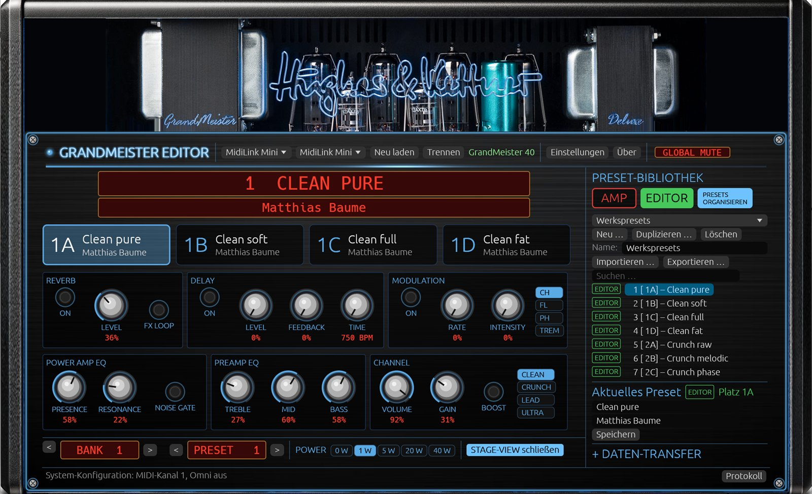
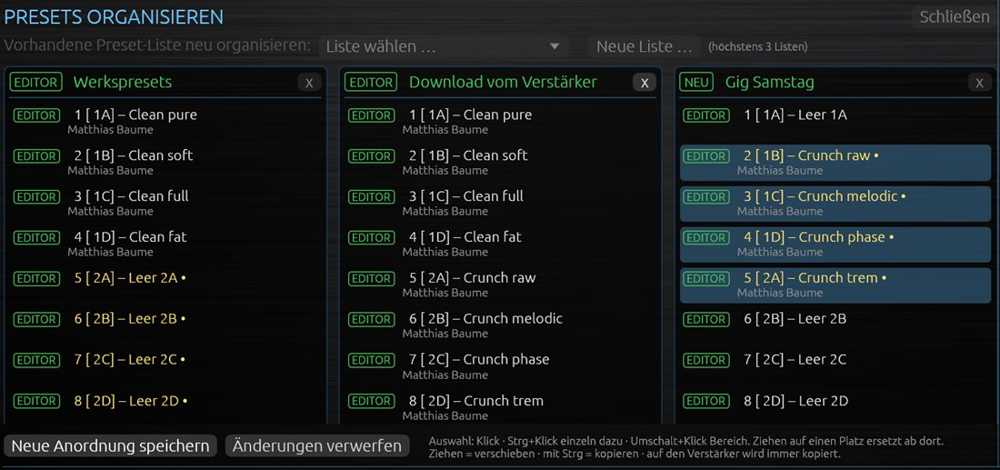

# GrandMeister Editor

**A Windows editor for the Hughes & Kettner GrandMeister 36 / Deluxe 40 guitar amplifiers via USB-MIDI.**
Shape your sound on the PC, manage and organise preset lists, and recall them on the amp – in a window that
looks like the amp itself.

**[⬇ Download the latest version](../../releases/latest)** · Windows 10 / 11 · free · no installation ·
English, Deutsch, Français, Español

---

## Features

- **All controls of the amp** – gain, EQ, channels (Clean / Crunch / Lead / Ultra), boost, noise gate,
  reverb, delay (with BPM display), modulation, FX loop, power soak, power-amp EQ and global mute.
- **Two modes:** **AMP** works directly with the 128 slots in the amplifier; **EDITOR** works with preset lists
  on the PC – also without the amp.
- **Preset library** with your own lists: new, duplicate, rename, search, import/export (format of the
  original app), reorder by drag & drop.
- **ORGANISE PRESETS** – up to three lists side by side (amp and/or editor lists), multiple selection,
  move and copy by drag & drop.
- **DATA TRANSFER** – load all presets from the amp into a new list, or transfer a list into the amp.
- **LIVE-ON-STAGE-VIEW** – four large buttons for the presets of the current bank.
- **Compare with the original sound**, changed controls are marked.
- **Light effects** – when the amp is detected, the neon lettering lights up and the tubes start to glow.
- The interface size adapts to your screen (also Full HD).
- **Portable** – a single exe; library and settings live in the folder `GrandMeister-Editor-Daten` next to it.

| | |
|---|---|
|  |  |

## What you need

- A Windows PC (Windows 10 or 11) and a **USB-MIDI interface** with MIDI IN and MIDI OUT (e.g. a MidiLink Mini)
  plus two MIDI cables.
- Optionally the **FSM-432 MK III** footswitch: computer OUT → FSM IN, FSM OUT → amp IN, amp OUT → computer IN.

## Getting started

1. Download `GrandMeister-Editor-1.0.0-windows.zip` from the [releases page](../../releases/latest) and unzip it.
2. Start `GrandMeister-Editor.exe`.
   > **First start:** Windows may show *“Windows protected your PC”* (SmartScreen) because the editor is
   > not digitally signed. Click **More info → Run anyway**. Alternatively: right-click the exe →
   > **Properties** → tick **Unblock** → OK.
3. Choose the **MIDI input** and **MIDI output** at the top and click **Connect**. After a few seconds the
   detected model appears (e.g. *GrandMeister 40*).

📖 **Manual:** [Quick Guide (English, PDF)](docs/GrandMeister-Editor_Quick-Guide_EN.pdf) ·
[Kurzanleitung (Deutsch, PDF)](docs/GrandMeister-Editor_Kurzanleitung_DE.pdf)

🎬 **Demo film (2:33 min):** [watch on YouTube (English)](https://youtu.be/WCA3SVyyYxQ) ·
[auf YouTube ansehen (Deutsch)](https://youtu.be/CDIQXMvOJtY)

## Good to know

- Fully tested with the **GrandMeister Deluxe 40**. A GrandMeister 36 was not available for testing; its support
  follows the behaviour of the original app.
- When connecting, the editor switches *global power-amp EQ* and *global power soak* off in the amp, so that
  every preset first plays with its own values. They can be switched on again in the settings.
- Before rearranging the slots in the amp, back them up with **DATA TRANSFER → Download**.

## Feedback

Found a bug or have an idea? Please open an [issue](../../issues).

☕ **Enjoying the editor?** The GrandMeister Editor is free and a private hobby project. If it saves you time,
you can support it with a coffee: [buymeacoffee.com/maba](https://buymeacoffee.com/maba) – thank you!

## Licence

The GrandMeister Editor is **freeware** – free to use privately and commercially; see [LICENSE.txt](LICENSE.txt).
It uses open-source components under their own licences, listed in [THIRD-PARTY-NOTICES.txt](THIRD-PARTY-NOTICES.txt).
The source code is currently not published.

The photos of the GrandMeister amplifier are used with kind permission of Hughes & Kettner.
Hughes & Kettner and GrandMeister are trademarks of their respective owners. The GrandMeister Editor is a private
project by Matthias Baume and not an official Hughes & Kettner product.

---

## Deutsch

Der **GrandMeister Editor** ist ein kostenloser Windows-Editor für die Verstärker Hughes & Kettner
GrandMeister 36 / Deluxe 40 über USB-MIDI: Sound bearbeiten, Preset-Listen verwalten und organisieren, Presets im
Verstärker abrufen und übertragen. Ohne Installation, Oberfläche in Deutsch, Englisch, Französisch und Spanisch.

**[Download](../../releases/latest)** · [Kurzanleitung (PDF)](docs/GrandMeister-Editor_Kurzanleitung_DE.pdf) ·
[Vorführfilm auf YouTube (2:33 min)](https://youtu.be/CDIQXMvOJtY) ·
☕ [Spendier mir einen Kaffee](https://buymeacoffee.com/maba)

> **Beim ersten Start** zeigt Windows eventuell „Der Computer wurde durch Windows geschützt“. Dann auf
> **Weitere Informationen → Trotzdem ausführen** klicken (oder vorab: Rechtsklick auf die Exe → Eigenschaften →
> „Zulassen“ anhaken).
